<!--
  SETUP: 1) put header.svg inside an "assets" folder in this repo  2) add the snake workflow  3) replace YOUR_USERNAME and YOUR_EMAIL
-->

 

  

 

---

<h2 align="center">👋 &nbsp;About Me</h2>

I build **secure, scalable mobile and full-stack products** for banking, fintech and insurance.
I lead with clean architecture, care about security and quality, and enjoy turning complex business flows into smooth user experiences.

 

<table align="center">
<tr>
<td align="center" width="25%">
<h3>📱</h3>
<b>Mobile Engineering</b> 
Flutter, Kotlin, React Native, Java; native bridges, store releases, performance
</td>
<td align="center" width="25%">
<h3>🔐</h3>
<b>Mobile Security</b> 
Pinning, biometrics, secure storage, root/jailbreak detection
</td>
<td align="center" width="25%">
<h3>⚙️</h3>
<b>Back-End &amp; APIs</b> 
Node.js, TypeScript, Python, PHP, .NET microservices
</td>
<td align="center" width="25%">
<h3>🧪</h3>
<b>Test Automation</b> 
Appium, Robot Framework, Selenium, JMeter, Postman
</td>
</tr>
</table>

 

---

<h2 align="center">🧠 &nbsp;Tech Arsenal</h2>

<h3>📱 Mobile</h3>

 

<h3>⚙️ Back End</h3>

<h3>🗄️ Databases &amp; Cloud</h3>

<h3>🌐 Web &amp; Design</h3>

<h3>🤖 Test Automation</h3>

<h3>🛠️ DevOps &amp; Tools</h3>

 

### 🧩 Patterns &amp; Practices

### 🔐 Security Focus

 

---

<h2 align="center">📈 &nbsp;Contribution Activity</h2>

<picture>
  <source media="(prefers-color-scheme: dark)" srcset="assets/snake-dark.svg" />
  <source media="(prefers-color-scheme: light)" srcset="assets/snake.svg" />
  
</picture>

 

---

<h2 align="center">📌 &nbsp;Featured Projects</h2>

<table align="center">
<tr>
<td width="50%" valign="top">

### 🛡️ Tawuniya Insurance Mobile App
**Senior Mobile Team Lead / Flutter Developer** · Mobcoder · Jul 2025 – Mar 2026

Led Flutter delivery of a member-facing insurance mobile app: architecture, code reviews, sprint planning and release management with the team.

`Flutter` `Dart` `REST APIs` `Team Lead` `Agile`

🔒 Client project (private repository)

</td>
<td width="50%" valign="top">

### 🏦 Leader Investment Group: Mobile Banking &amp; Investment
**Senior Flutter Developer** · LIG, Riyadh · Mar 2023 – 2025

Built secure mobile banking and investment features on Flutter and .NET back ends, with CI/CD through App Center and iOS beta distribution on TestFlight.

`Flutter` `.NET` `Microservices` `Mobile Security` `CI/CD`

🔒 Client project (private repository)

</td>
</tr>
<tr>
<td width="50%" valign="top">

### 🩺 PhysioTally
**Personal product** · Live on Google Play

Offline-first invoicing and receipt app for physiotherapists and clinics, designed to work without a connection.

`Flutter` `SQLite` `Offline-first` `Google Play`

</td>
<td width="50%" valign="top">

### 🥗 Clinical Dietitian Website
**Full-stack project** · Client and admin portals

Quotation and booking records, admin notification on new bookings, automatic call reminders every 7 days from a client's joining date, and diet-chart creation with PDF export from a template.

`PHP` `MySQL` `React` `PDF Export`

</td>
</tr>
</table>

 

---

<h2 align="center">🎯 &nbsp;Currently</h2>

| | |
|:--|:--|
| 🔭 **Working on** | Reusable Flutter security and architecture kits |
| 📚 **Learning** | SwiftUI, Flutter performance profiling, platform channels |
| 🤝 **Looking for** | Flutter / Mobile Lead roles in Dubai and the UAE |
| 💬 **Ask me about** | Flutter, mobile security, Node.js / TypeScript / .NET APIs, mobile test automation |

 

---

<h2 align="center">🤝 &nbsp;Let's Connect</h2>

Have a project, a role, or just want to talk mobile? Reach out.

 

 

Built with care · Thanks for visiting 👋

